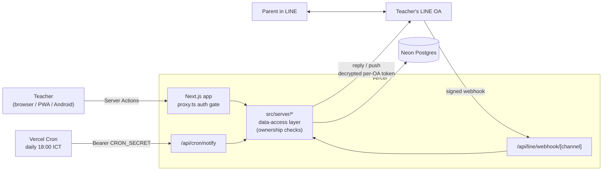
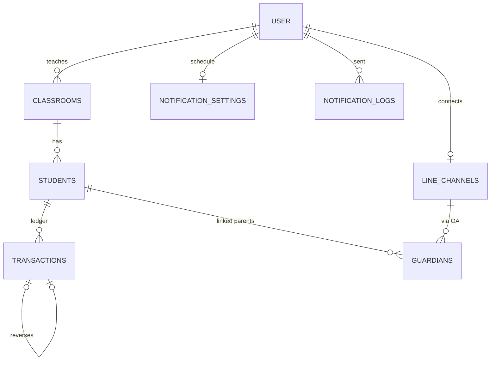

# กระปุกห้องเรียน · Classroom Savings Bank

A full-stack web app (plus an Android app) that lets Thai primary-school teachers run a classroom savings bank: record students' deposits and withdrawals, keep an auditable history, and send each parent a weekly balance card through the teacher's own **LINE Official Account**.

**Live:** https://kid-savings-bank.vercel.app · **Android APK:** [download](https://kid-savings-bank.vercel.app/download/kid-savings-bank.apk)

> ภาษาไทย: [ขั้นตอนการพัฒนาโปรเจกต์](docs/DEVELOPMENT.th.md) · [คู่มือติดตั้งและดูแลระบบ](docs/SETUP.th.md)

---

## The problem

Many Thai schools run a "ธนาคารโรงเรียน" (school savings bank): every morning the teacher collects a few baht from each child and writes it down in a paper ledger. Totals get miscounted, the book can be lost, and parents only find out the balance at the end of term.

This app replaces the paper ledger with a phone-first tool built for **30–50 teachers and ~1,000 students**. Parents get their child's balance in **LINE**, the messaging app almost every Thai family already uses.

## Features

**For teachers**
- Sign in with LINE (no passwords to remember)
- Create classes and bulk-add students by pasting a list
- Deposit with one tap on quick amounts (5 / 10 / 20 / 50 / 100 ฿), or any amount down to the satang
- Every deposit and withdrawal goes through a **confirmation step** that shows the balance before and after
- Undo a mistake within seconds, or reverse an older entry with a visible audit record
- Per-student history with a month filter, and a class summary
- Export a class to Excel (summary sheet + full ledger)
- Settings: light/dark theme, account, LINE OA connection, notification schedule
- Installable as a PWA, or as an Android app (Trusted Web Activity)

**For parents (inside LINE, no app to install)**
- Link to their child with a 6-digit code from a printed invitation, plus an explicit consent step
- Tap **💰 ยอดเงิน** at any time to get a Flex card: current balance plus this week's entries (Mon–Sun)
- Receive an automatic weekly summary; type `ยกเลิก` to stop

**Multi-tenant LINE integration**
- Each teacher pastes their own OA keys. The app validates the token, identifies the OA, **sets the webhook URL automatically**, and asks LINE to test it.
- Keys are encrypted at rest with AES-256-GCM
- Each OA gets its own webhook endpoint, and requests are verified with HMAC signatures
- The Settings page checks the webhook live and can repair it with one click if it points somewhere else

## Tech stack

| Layer | Choice |
|---|---|
| Framework | Next.js 16 (App Router, Server Components, Server Actions), React 19, TypeScript |
| UI | Tailwind CSS 4, shadcn/ui (Radix), lucide icons, next-themes, IBM Plex Sans Thai |
| Database | PostgreSQL on Neon (serverless) · PGlite (embedded Postgres) for zero-setup local dev |
| ORM / migrations | Drizzle ORM + drizzle-kit |
| Auth | Better Auth with LINE Login (OpenID Connect) |
| Messaging | LINE Messaging API (Flex messages, quick replies, postbacks, webhooks) |
| Validation | Zod 4 |
| Hosting | Vercel (serverless functions + Cron) |
| Mobile | PWA (manifest, service worker, offline page) + Android TWA built with Bubblewrap |
| Other | ExcelJS (export), qrcode, sonner (toasts) |

## Architecture



### Data model (simplified)



## Engineering decisions worth noting

- **Append-only ledger.** No row stores a balance; balances are always `SUM` over `transactions`. A correction is a new *reversal* entry (`reverses_id` is unique, so an entry can be reversed only once), which keeps the history auditable.
- **Money as integers.** Amounts are stored in satang (1 ฿ = 100 satang), with a `CHECK amount > 0` constraint, so there are no floating-point errors.
- **No negative balances under concurrency.** Withdrawals and reversals lock the student row with `SELECT … FOR UPDATE` inside a transaction before checking the balance.
- **Tenant isolation in one place.** Pages and actions never touch `db` directly. Every query goes through `src/server/*`, which scopes it to the signed-in teacher; other teachers' IDs return 404.
- **Students with history are archived, not deleted.** Class totals count only active students.
- **Identifying a LINE OA reliably.** LINE can't verify a long-lived token against a Channel ID, so the app identifies each OA by the bot `userId` from `/v2/bot/info`. Two teachers sharing a school OA therefore resolve to the same channel.
- **Secret rotation without downtime.** A newly entered channel secret is kept as *pending* and promoted only after a webhook arrives with a valid signature.
- **Free-tier friendly.** Pull-based "ยอดเงิน" replies don't count toward LINE's monthly quota; weekly pushes fit within 300 messages/OA/month for a typical class. The cron job is idempotent (`last_sent_on`), so a retry never double-sends.
- **Zero-setup local dev.** With no `DATABASE_URL` the app runs on embedded PGlite; migrations run automatically in `predev`; a lock file prevents two processes opening the same data directory; `LINE_DRY_RUN=1` logs messages instead of sending them.

## Getting started

Requires Node.js 22+.

```bash
npm install
cp .env.example .env.local   # fill BETTER_AUTH_SECRET; everything else is optional locally
npm run dev                  # runs migrations, then starts http://localhost:3000
```

Teachers can sign in with LINE Login or sign up with email + password (no email verification). See [docs/SETUP.th.md](docs/SETUP.th.md) for the LINE Login channel, OA setup, deployment, and building the Android APK.

| Script | Purpose |
|---|---|
| `npm run dev` | Migrate, then start the dev server (Turbopack) |
| `npm run build` / `start` | Production build / serve |
| `npm run lint` | ESLint |
| `npm run db:generate` | Create a migration after editing `src/db/schema.ts` |
| `npm run db:migrate` | Apply migrations (Neon if `DATABASE_URL` is set) |
| `npm run db:studio` | Browse data in Drizzle Studio |

## Project structure

```
src/
  app/
    (app)/classes/          classes, students, deposit/withdraw dialog, history, parents, Excel export
    (app)/settings/         account, theme, install app, LINE OA connection, notification schedule
    api/auth/               Better Auth handler (LINE Login)
    api/line/webhook/[channel]/   per-OA webhook (signature-verified)
    api/cron/notify/        weekly parent notifications (Vercel Cron)
    api/cron/cleanup/       weekly: deletes teacher accounts inactive for 1 year (?dryRun=1 to preview)
    login/                  sign-in page
  db/                       Drizzle schema + Neon/PGlite client
  lib/                      auth config, money parsing/formatting, Bangkok-time scheduling, validation
  server/                   data-access layer: money, notify, LINE API, encryption, export
  proxy.ts                  redirects signed-out users to /login
drizzle/                    SQL migrations
android/                    Bubblewrap TWA project (signing key not committed)
docs/                       Thai documentation
```

## Testing

The project has no automated test suite yet. Every phase was verified with scripted end-to-end runs in a real browser against a local database, then smoke-tested in production. The runs covered:

- Auth redirects and cross-teacher 404s
- Deposit, withdraw, undo, and reversal arithmetic
- Class totals with archived students
- Month filters and Excel output
- Webhook isolation between OAs
- Weekly reset of the parent card
- Cron authorization

Adding Vitest unit tests for `src/lib/money.ts` / `src/lib/schedule.ts` and Playwright flows is the next step.


